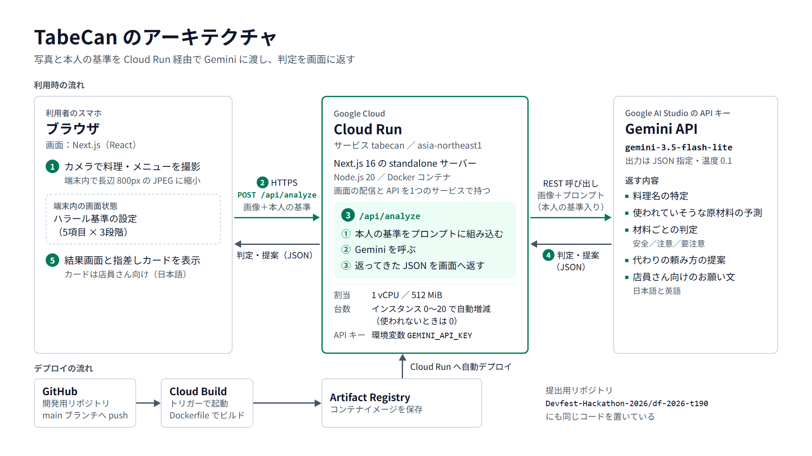

# TabeCan (タベキャン) - ハラール食判定＆安心外食サポートアプリ

> **DevFest Hackathon 2026 提出作品**  
> 訪日外国人・ムスリムが日本の飲食店で「これ食べられるかな？」と悩む不安を解消し、安心して日本の食文化を楽しむためのWebアプリケーションです。

---

## 🚀 公開URL（Google Cloud Run デプロイ済み）

### 🔗 **https://tabecan-288344990778.asia-northeast1.run.app**
*(Google Cloud Run 上で本番稼働中！スマートフォン・PCどちらのブラウザからでもカメラ撮影・画像解析をお試しいただけます)*

> ※ 予備ミラーURL: https://tabe-can.vercel.app

---

## ✨ 主な機能

1. **📸 メニュー・料理のリアルタイムAI画像判定 (Gemini API)**
   - メニューや料理の写真を撮るだけで、ハラール対応状況（OK / 注意 / NG）を瞬時に判定。
   - 豚肉由来成分やみりん・料理酒などのアルコール含有リスクをわかりやすく表示します。

2. **💡 AIによる安全な代替提案（迷わせない2択）**
   - **✨ AIからの提案**: 日本の一般的な飲食店にある調味料（塩、植物由来の油など）への代替で食べられる方法を提案。
   - **🚫 食材抜きでの注文**: 該当食材を抜くことで食べられるかを提案。

3. **🤝 店員さん指差し交渉カード（1タップで意思疎通）**
   - 日本語が話せない外国人旅行者でも、画面を店員さんに見せるだけで「代替調理が可能か」を指差し確認できるカードを自動生成。
   - 店員さんが回答ボタン（「はい」「ごめんなさい。対応できません」）を押すだけで次のアクションへスムーズにナビゲート。

4. **🌐 日英バイリンガル＆直感的なUI**
   - 画面右上のスイッチで「日本語 / English」をワンタップ切り替え。
   - 英語モード時でも、店員さんに見せる指差しカードのメイン文は常に日本語で大きく表示されるため、確実なコミュニケーションが可能です。

---

## 🛠️ 技術スタック
- **実行基盤 / ホスティング**: **Google Cloud Run**（ハッカソン必須条件達成）、Cloud Build、Docker
- **AI / 画像認識**: **Google Gemini API** (`gemini-3.5-flash-lite`、環境変数 `GEMINI_MODEL` で変更可)
- **フロントエンド / バックエンド**: Next.js (App Router), TypeScript, Tailwind CSS, Lucide React

---

## アーキテクチャ



- 利用者のブラウザで撮った写真を端末内で長辺 800px の JPEG に縮小し、本人のハラール基準と一緒に `POST /api/analyze` へ送ります。
- Cloud Run 上の Next.js（standalone サーバー）が、基準を組み込んだプロンプトと画像を Gemini API に渡し、返ってきた JSON の形を確かめてから画面へ返します。
- デプロイは開発用リポジトリの main ブランチへの push から Cloud Build → Artifact Registry → Cloud Run の順に自動で行われます。この提出用リポジトリにも同じコードを置いています。

---

## ローカルでの動かし方

Node.js 20.9 以上が必要です（Docker イメージは Node.js 20 を使っています）。

```bash
npm ci
cp .env.example .env.local   # GEMINI_API_KEY を自分のキーに書き換える
npm run dev
```

ブラウザで http://localhost:3000 を開きます。

| 環境変数 | 必須 | 内容 |
| --- | --- | --- |
| `GEMINI_API_KEY` | 必須 | [Google AI Studio](https://aistudio.google.com/) で発行した Gemini API キー。`.env.local` に書き、コミットしない |
| `GEMINI_MODEL` | 任意 | 使う Gemini のモデル名。未設定なら `gemini-3.5-flash-lite` |

`GEMINI_API_KEY` が未設定のとき、`npm run dev` では固定のモック結果を返し、本番ビルドでは解析 API が 503 を返します。

lint とビルドの確認は `npm run lint` と `npm run build` で行えます。

---

## ディレクトリ構成

```text
.
├── src/
│   ├── app/
│   │   ├── page.tsx              # 画面すべて（ホーム・カメラ・解析中・結果・指差しカード・設定）
│   │   ├── layout.tsx            # HTML の骨組み。Tailwind CSS（CDN）と Google Fonts の読み込み
│   │   ├── globals.css           # 共通スタイルと判定バッジの色
│   │   └── api/analyze/route.ts  # 解析 API。入力の検証 → Gemini 呼び出し → 応答 JSON の検証
│   ├── lib/analyze/
│   │   ├── prompt.ts             # Gemini に渡す判定プロンプト
│   │   └── mock.ts               # デモ・開発用のモック判定結果
│   ├── types/index.ts            # 共通の型（ユーザー設定・解析結果）
│   └── db/schema.sql             # DB スキーマ案（現在は未使用）
├── public/                       # 静的ファイル置き場（Dockerfile がコピーするため空でも残す）
├── docs/architecture.png         # アーキテクチャ図
├── docs/schema-v2.md             # 判定スキーマ v2 の設計（決勝に向けて）
├── design.md                     # 画面・デザインの仕様
├── Dockerfile                    # Cloud Run 用のコンテナ（Next.js standalone）
└── .gemini/skills/hallmark/      # 第三者のデザインスキル Hallmark の同梱物（lint の対象外）
```

---

## DevFest Hackathon 2026 提出用リポジトリについて

  DevFest Hackathon 2026 のチームの **最終提出用** リポジトリです。提出期限までに、作品のコードと資料をこのリポジトリに置いてください。

  このリポジトリは **公開（public）** です。開催中も、運営・審査員・ほかの参加者が見られます。

  ## はじめに

  1. GitHub から届いた招待を受け入れてください（招待の期限は 7 日です）
  2. このリポジトリを clone して、提出物を置いてください

  招待の期限が切れたときや、メンバーが変わったときは、運営に連絡してください。

  ## 開発用のリポジトリは別に作ることをおすすめします

  このリポジトリでは **GitHub Actions と GitHub Pages が使えません**。CI やデプロイ、Pages での公開をしたいときは、チームで開発用のリポジトリを別に作ってください。

  - 開発用のリポジトリは、チームのメンバーのアカウントや、チームで作った Organization に作ってください
  - 開発はそちらで進めて、提出期限までに最終版のコードと資料をこのリポジトリに push してください
  - 審査はこのリポジトリの内容で行います。開発用のリポジトリにしかないものは、審査の対象になりません
  - デプロイした作品の URL があれば、この README に書いてください

  ## 秘密情報をコミットしない

  API キー・パスワード・サービスアカウントの鍵などは、**絶対にコミットしないでください**。公開リポジトリなので、push
  した時点で誰でも見られます。開発用のリポジトリから持ってくるときも、履歴ごと push すると、過去のコミットに含まれる秘密情報も公開されます。

  - 秘密情報は `.env` や `.dev.vars` などに書き、コミットしない（`.gitignore` に入れてあります）
  - 誤って push したら、すぐにキー（鍵）を無効にして作り直し、運営に連絡してください。履歴から消すだけでは不十分です
  - GitHub の push protection が、よく知られた形式のキーの push を止めることがあります。止められたら、そのキーをコミットから外してください

  ## 提出

  提出の方法と締切は、運営からの案内に従ってください。提出期限を過ぎると、このリポジトリは読み取り専用になり、push できなくなります。

  ## ライセンス

  [MIT License](LICENSE) です。ほかのライセンスにしたいときは、LICENSE を書き換えてください。
